# FND-2063: Mission path shown as straight line between POIs

## Summary

The planner would occasionally produce a straight-line path segment that cuts
directly through an obstacle / No-Go zone, instead of routing around it. This
was reproduced and root-caused in `grid_map_proc`'s path-shortcutting logic and
fixed with a small, targeted change plus a red/green-verified regression test.

## Root cause

`grid_map_path_planning::shortCutValid()`
([include/grid_map_proc/grid_map_path_planning.h](include/grid_map_proc/grid_map_path_planning.h))
decides whether a straight-line "shortcut" between two path waypoints is safe
to take. Before the fix, it only checked one condition along the line:

```cpp
if ( (dist_trans_map(index(0), index(1)) < 11.0) && !is_end_point ){
  return false;
}
```

i.e. "reject the shortcut if any cell on the line has a `distance_transform`
value less than 11 (too close to an obstacle)".

The problem: `distance_transform` (computed in
[src/grid_map_transforms.cpp](src/grid_map_transforms.cpp)'s
`addDistanceTransform()`) is initialized to `FLT_MAX` everywhere and then only
propagated, via BFS, from "reachable obstacle cells" — obstacle cells that
border free space reachable from the seed/start pose — outward through cells
that are themselves free (`occupancy == 0.0`). Any obstacle cell that is
**never touched by that wavefront** is left at `FLT_MAX` forever. This happens
for:

- The interior of a thick wall (more than one cell deep), or
- An obstacle that is entirely surrounded by unknown/unexplored (`NaN`) space,
  never bordering a reachable free cell (matches the ticket's attached
  "isolated wall in NaN sea" reproduction scenario).

Since `FLT_MAX < 11.0` is `false`, `shortCutValid()` treated these cells as
"far from any obstacle" — i.e. safe — and allowed a shortcut line to run
straight through them, producing the reported straight-line-through-obstacle
path.

(Root cause matches the analysis already posted in the JIRA ticket by another
engineer; this work reproduced it independently and implemented + verified the
fix.)

### Why this can really happen in practice (not just a contrived test map)

It's reasonable to ask: the mission path is generated one grid cell at a time
via gradient descent on `exploration_transform`
([src/grid_map_transforms.cpp](src/grid_map_transforms.cpp)), so doesn't that
dense, cell-by-cell path already avoid the obstacle on its own — before
`shortCutPath` ever gets a chance to shortcut it?

It does avoid it — but that's exactly what sets up the bug, not what prevents
it. Both `addDistanceTransform`'s `touchDistCell` and
`addExplorationTransform`'s `touchExplorationCell` reject a cell outright if
it isn't exactly free:

```cpp
//If not free at cell, return right away
if (grid_map(idx_x, idx_y) != 0)
  return;
```

(`NaN != 0` is also `true` under IEEE-754, so this excludes occupied *and*
unknown/NaN cells alike.) So `exploration_transform` is a wavefront that only
ever spreads through free, explored cells — it flows *around* any obstacle or
unexplored blob like water around an island, never through it. The dense,
per-cell path (gradient descent on that field) inherits the same property:
every single waypoint it visits is guaranteed free.

The problem is what happens on the far side of that detour. Picture the
wavefront wrapping around a "peninsula" of unknown space with a real,
previously-glimpsed obstacle buried inside it:

```
                    +---------------------------+
                    |     unknown / unexplored   |
                    |     (never reached by      |
                    |      the BFS wavefront)    |
                    |                             |
              ______|      +-----------+          |______
             /       \     |   ####    |         /        \
   free     /         \    |   ####    |        /          \    free
  space -- P ---------- \  +-----------+  / ---------------- Q -- space
            \            \_______________/                /
             \___________________________________________/

   dense path: ... -> P -> (long way around the peninsula) -> Q -> ...
   P and Q are far apart in PATH INDEX / arc-length, but geometrically close.
   shortCutPath tries connecting them directly - the straight line crosses
   straight through the unexplored pocket and the "####" obstacle inside it.
```

The dense path has to travel a long way *around* the island by cell-count,
but the two sides of that detour (`P` and `Q`) can be geometrically very
close in a straight line — the island sits right between them.
`shortCutPath`'s inner loop doesn't care about arc-length or path index; it
tries every `test_idx` from `idx+2` up to the end of the path, so it will
happily propose connecting two waypoints from opposite sides of the detour.
Before the fix, the only thing standing between "propose" and "accept" was
`dist_trans_map < 11.0` — which is blind to exactly this island's interior,
since the BFS never reached it.

So the realistic real-world trigger isn't a contrived test map, it's any of:
- A pillar/box/hazard that's been *seen* (occupied cells marked from a
  distance, e.g. a single lidar hit) but whose surroundings haven't been
  driven close enough to for the BFS to link it to reachable free space yet
  (partially-explored map).
- Any frontier/peninsula shape in the map where free space wraps around a
  concave, unexplored pocket.

This also matches the ticket's own attached reproduction screenshot
("isolated wall in NaN sea"), confirming it as an observed real-mission
pattern rather than a purely theoretical one.

## Fix

Added an explicit occupancy check in `shortCutValid()`, evaluated *before* the
existing distance-transform check, so a shortcut is rejected outright if any
non-endpoint cell on the line is not confirmed free (i.e. occupied **or**
unknown/`NaN`):

```cpp
if ( (occupancy_map(index(0), index(1)) != 0.0) && !is_end_point ){
  return false;
}
```

To make the occupancy layer available inside `shortCutValid()`, a new
`occupancy_map` parameter was added, and an `occupancy_layer` (default
`"occupancy"`) string parameter was threaded through the call chain:

- `shortCutValid()` — new `occupancy_map` parameter.
- `shortCutPath()` — new `occupancy_layer` parameter (default
  `"occupancy"`); looks up the layer and passes the matrix into
  `shortCutValid()`.
- `findPathExplorationTransform()` — passes its own `occupancy_layer` through
  to `shortCutPath()`.

**Files changed:**
- [include/grid_map_proc/grid_map_path_planning.h](include/grid_map_proc/grid_map_path_planning.h)
- [src/grid_map_path_planning.cpp](src/grid_map_path_planning.cpp)

Build verified clean via `catkin build grid_map_proc` (only pre-existing CMake
deprecation warnings, no errors/new warnings).

## Regression test

Added
[test/test_shortcut_through_isolated_obstacle.cpp](test/test_shortcut_through_isolated_obstacle.cpp)
(Catch2, part of the existing `grid_map_proc_tests` binary via `catch_ros`).

The test builds a map that is free everywhere except a 20x20-cell NaN/unknown
blob with a 4x4-cell solid obstacle island buried in its center. The obstacle
island only touches NaN neighbors, so it never borders reachable free space —
its `distance_transform` value is confirmed (via `REQUIRE`) to stay `FLT_MAX`,
exactly the bug's precondition. It then calls the public `shortCutPath()` API
on a 3-point path that detours around the blob, and checks that the detour
waypoint is still present in the output path (i.e. the planner did not collapse
the path into a straight line through the obstacle).

Run with:
```bash
catkin build grid_map_proc --force-cmake
devel/.private/grid_map_proc/lib/grid_map_proc/grid_map_proc_tests "[FND-2063]" -s
```

### Test scenario schematic

Map layout (illustrative, not to exact cell scale — see the test source for
exact coordinates):

```
Legend:
  .  free space            (occupancy == 0.0)
  ?  unknown / unexplored  (NaN)
  #  obstacle island       (occupancy == 100.0), isolated inside the NaN blob
  A  path_in[0] - start waypoint   (free space, left of the blob)
  B  path_in[1] - detour waypoint  (free space, below the blob)
  C  path_in[2] - end waypoint     (free space, right of the blob)
```

**Before the fix — rejected only by luck, not by design:** a naive shortcut
straight from `A` to `C` cuts directly through the isolated obstacle `#`.
`distance_transform` at `#` is `FLT_MAX` (the BFS never reaches it, since it
never borders reachable free space), so the old `dist < 11.0` check alone
never rejects it:

```
              +-------------- NaN blob (?) ----------------+
              |                                            |
              |              +-----------+                 |
              |              |   ####    |  <- obstacle,   |
   A - - - - -| - - - - - - -|-- #### ---|- - - - - - - - -|- - - - - C
              |              |   ####    |     always      |
              |              +-----------+   FLT_MAX        |
              |                                            |
              +--------------------------------------------+

   A ------------------- straight-line shortcut ------------------ C
   cuts directly through "####".  shortCutValid() used to accept this
   because dist_trans_map(#) == FLT_MAX, and FLT_MAX < 11.0 is false.
```

**After the fix — `B` is required, the shortcut through `#` is rejected:**
the new occupancy check in `shortCutValid()` rejects *any* line through a
non-free cell (occupied or NaN), regardless of its `distance_transform`
value, so the planner must keep the detour waypoint `B`:

```
              +-------------- NaN blob (?) ----------------+
              |                                            |
              |              +-----------+                 |
   A          |              |   ####    |                 |          C
    \         |              +-----------+                 |         /
     \        +--------------------------------------------+        /
      \                                                             /
       \                                                           /
        +----------------------------- B ---------------------- +

   A -> B -> C detour path stays entirely in free space, routing below
   the blob. The test asserts that B survives in path_out (see gotcha #2
   below - checking path_out.size() alone is not sufficient).
```

Test flow:

```mermaid
flowchart TD
    A[Build GridMap: free everywhere,<br/>20x20 NaN blob w/ 4x4 obstacle island buried inside] --> B[addDistanceTransform seeded from free space]
    B --> C{Sanity check:<br/>obstacle cell occupancy==100<br/>AND distance_transform==FLT_MAX?}
    C -->|no| F1[FAIL: test map no longer<br/>reproduces bug precondition]
    C -->|yes| D[shortCutPath&#40;map, path_in = A,B,C&#41;]
    D --> E{Is detour waypoint B<br/>present in path_out?}
    E -->|yes, PASS| G[Fix present: shortcut through # correctly rejected]
    E -->|no, FAIL| H[Bug reproduced: shortcut cut straight through # obstacle]
```



### Two gotchas hit while designing the test

1. **Masking by an unrelated, correct check.** A first attempt used a solid
   full-height wall directly adjoining open free space on both sides (no NaN).
   This did *not* reproduce the bug: free cells immediately next to the wall
   face have small, correctly-computed finite `distance_transform` values that
   already fail the ordinary `< 11.0` clearance check *before* the line ever
   reaches the wall's untouched-`FLT_MAX` interior — so the shortcut is
   (correctly) rejected for an unrelated, mundane reason, masking the actual
   bug. Fix: the obstacle must be unreachable from *any* nearby free cell
   (isolated in a NaN/unknown blob), not simply "thick".

2. **Assertion too coarse (size-only check).** `shortCutPath()`'s index
   bookkeeping does not collapse an erroneously-accepted shortcut to a clean
   2-element path — it produces a 3-element path with a *duplicated final
   point* (`[P0, P2, P2]`) when `shortCutValid()` wrongly returns `true` for a
   3-point input. So `CHECK(path_out.size() == 3)` alone passes in *both* the
   buggy and fixed code. The test instead explicitly checks that the
   detour/via waypoint itself is present in `path_out` (comparing
   `index(0)`/`index(1)` manually in a loop, since `grid_map::Index` has no
   usable `operator==` for `std::find`).

### Red/green verification

Verified via `git stash` (stashing only the two fixed source files, leaving
the new test file untracked) + rebuild + rerun:

- **Fix stashed out:** test **fails** — `CHECK( detour_point_present )` is
  `false` (bug reproduced).
- **Fix restored** (`git stash pop`) + rebuild: test **passes** —
  `detour_point_present` is `true`.

Full `grid_map_proc_tests` suite (pre-existing + new test) passes: 4 test
cases, 21 assertions, all green.

## Status

- [x] Root cause identified.
- [x] Fix implemented and compiles cleanly.
- [x] Regression test added and red/green verified.
- [ ] Commit/push — not yet done, pending confirmation.
